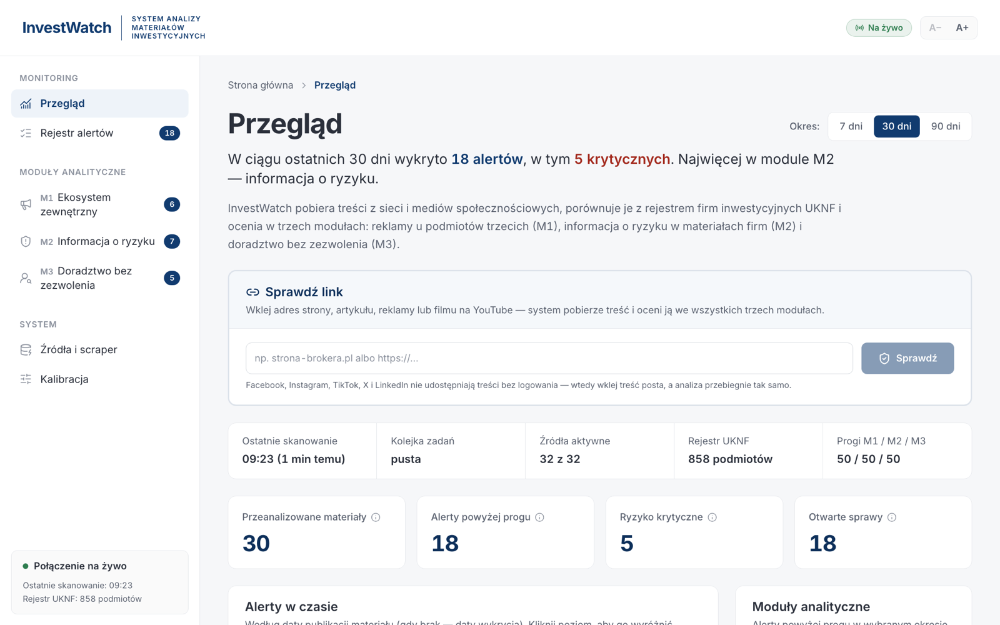
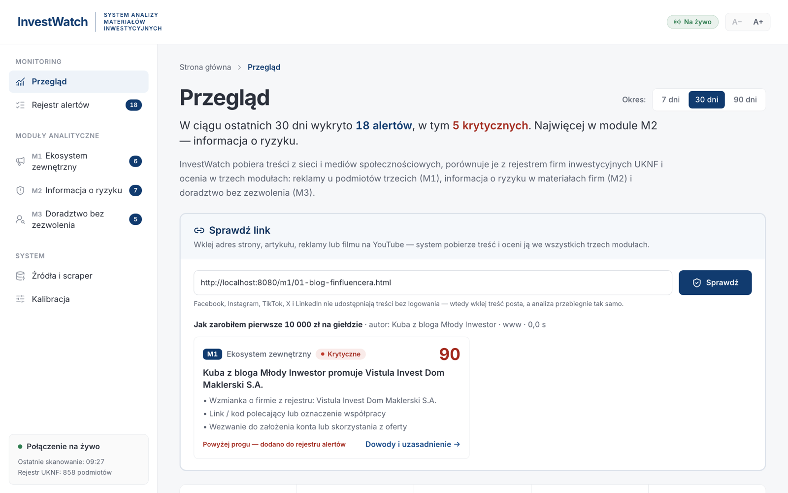
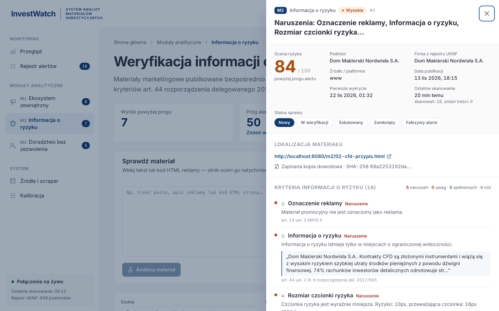
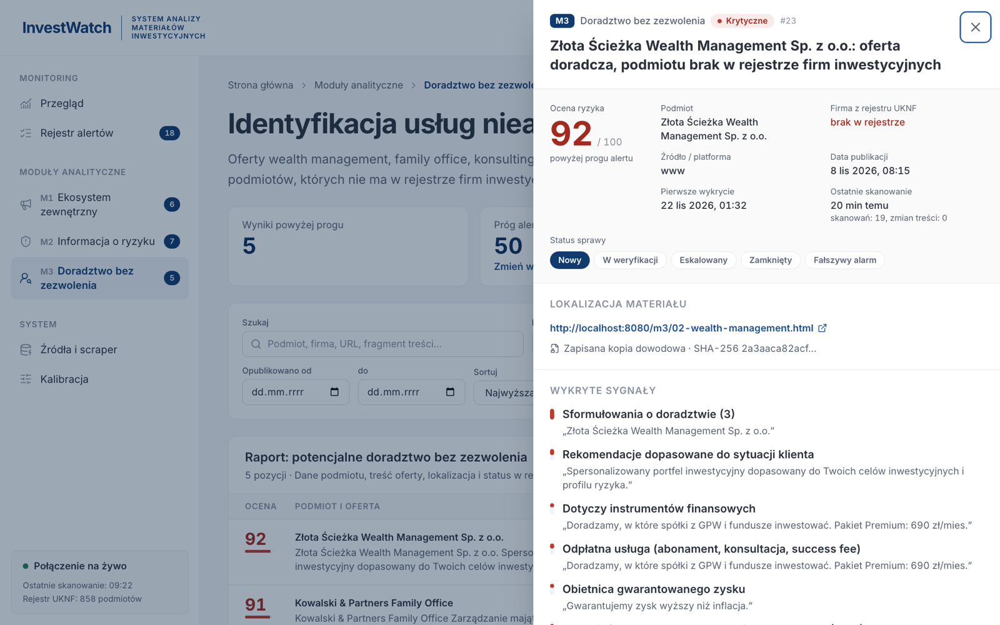
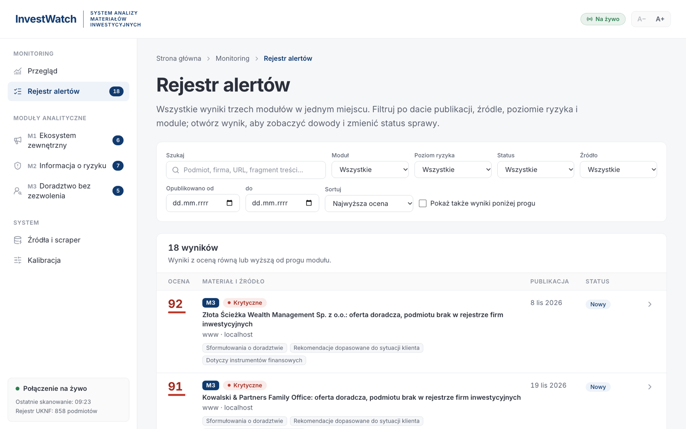
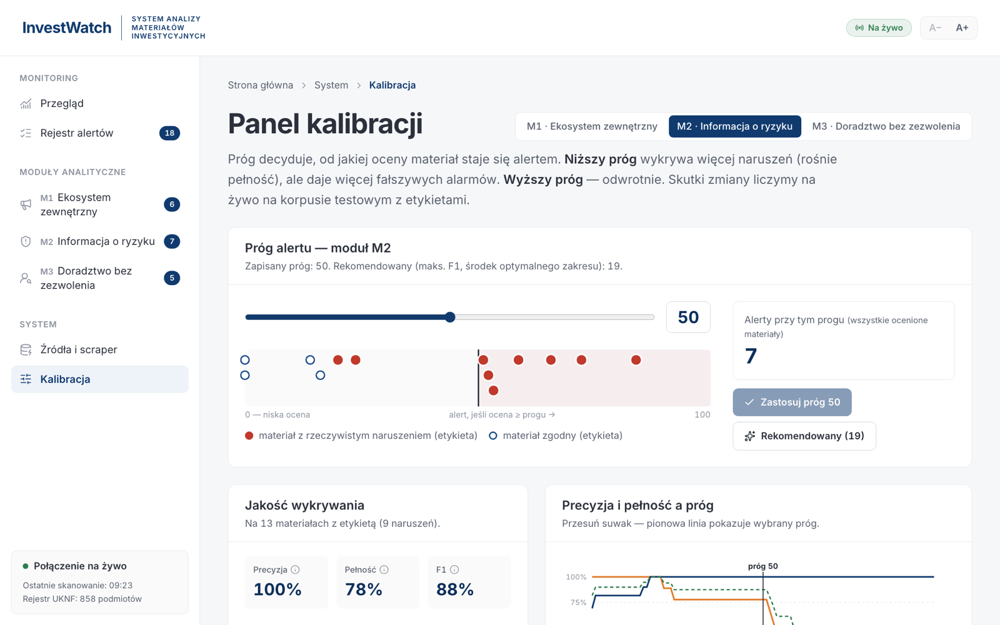
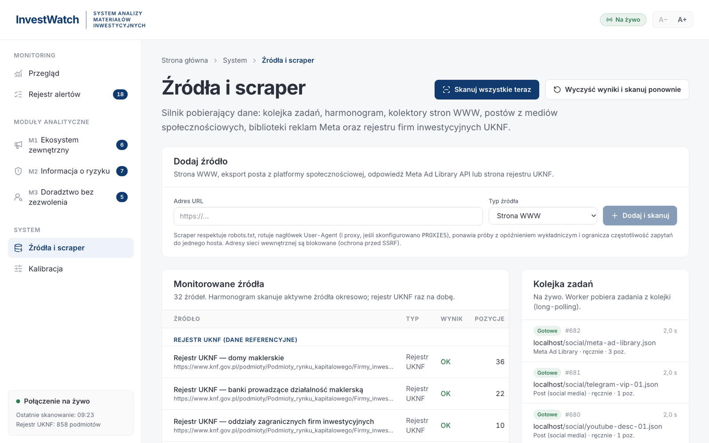

# InvestWatch — na straży inwestorów

**System, który sam wyszukuje w sieci reklamy i oferty inwestycyjne, ocenia je według przepisów
i pokazuje analitykowi UKNF dowody — na żywo.** Projekt na HackNation 2026 (wyzwanie UKNF).

[](docs/film/InvestWatch-film.mp4)

▶ [Obejrzyj film (1:21)](docs/film/InvestWatch-film.mp4) · 📄 [Prezentacja PDF](docs/prezentacja/InvestWatch-prezentacja.pdf)

| Moduł | Na jakie pytanie odpowiada |
|---|---|
| **M1** Ekosystem zewnętrzny | Kto reklamuje firmy inwestycyjne z rejestru UKNF (finfluencerzy, rankingi, reklamy) — gdzie i jak? |
| **M2** Informacja o ryzyku | Czy reklama firmy spełnia **18 kryteriów** informacji o ryzyku (art. 44 rozp. del. 2017/565, MiFID II)? |
| **M3** Doradztwo bez zezwolenia | Kto oferuje doradztwo inwestycyjne (family office, „sygnały”, grupy VIP), a nie ma go w rejestrze UKNF? |

---

## Uruchomienie (2 minuty)

Potrzebny jest [Docker](https://docs.docker.com/get-docker/).

```bash
git clone https://github.com/Molendakrol/investwatch.git && cd investwatch
cp .env.example .env          # zmień POSTGRES_PASSWORD i INTERNAL_TOKEN
docker compose up --build
```

Otwórz **http://localhost:3000**. System sam pobierze rejestr firm inwestycyjnych z knf.gov.pl
i przeskanuje korpus testowy — pierwsze alerty pojawią się po ok. 30 sekundach.

<details>
<summary>Bez Dockera</summary>

Python 3.11+ i Node 20+: `./scripts/dev.sh` → panel na http://localhost:8000 (baza SQLite).
</details>

---

## Jak korzystać

### 1. Przegląd — cały obraz ryzyka
Liczba alertów, podział na moduły i poziomy ryzyka, najnowsze wykrycia i aktywność systemu.
Wszystko odświeża się samo (WebSocket) — nowe alerty wysokiego ryzyka pojawiają się jako powiadomienia.



### 2. Sprawdź link — wynik w sekundę
Wklej adres strony, artykułu, reklamy lub filmu z YouTube i kliknij **Sprawdź**.
System pobierze treść, rozpozna firmę z rejestru UKNF i oceni materiał we wszystkich modułach.
Facebook, Instagram, TikTok, X i LinkedIn nie udostępniają treści bez logowania — wtedy wklej treść posta, a analiza przebiegnie tak samo.



### 3. Szczegóły sprawy — dowody i uzasadnienie
Kliknij dowolny alert. Zobaczysz ocenę 0–100, każde naruszone kryterium z **cytatem z materiału i podstawą prawną**,
kopię dowodową materiału (z sumą SHA-256) oraz przyciski statusu: *Nowy → W weryfikacji → Eskalowany → Zamknięty / Fałszywy alarm*.

| Moduł 2 — informacja o ryzyku | Moduł 3 — doradztwo bez zezwolenia |
|---|---|
|  |  |

### 4. Rejestr alertów — filtry i raporty
Filtruj po **dacie, źródle, poziomie ryzyka, module** i statusie. Na stronach modułów jest przycisk
**Eksportuj raport CSV** (np. dla M1: firma, podmiot reklamujący, treść, URL, daty wykrycia).



### 5. Kalibracja — Ty decydujesz o czułości
Przesuń suwak progu i od razu zobacz skutki: precyzję, pełność, F1 i macierz pomyłek na materiałach z etykietą.
Niższy próg = więcej wykrytych naruszeń, ale więcej fałszywych alarmów. **Zastosuj próg** zmienia alerty w całym systemie.



### 6. Źródła i scraper
Dodawaj źródła (strona WWW, eksport posta, Meta Ad Library API, rejestr UKNF), uruchamiaj skanowanie
i obserwuj kolejkę zadań na żywo. Harmonogram skanuje źródła co 30 minut, rejestr UKNF raz na dobę.



---

## Jak to działa

```
Źródła ──► worker (scraper) ──► analyzer (ocena) ──► api (baza, kolejka, WebSocket) ──► panel
```

- **worker** — kolejka zadań, rotacja User-Agent i proxy, robots.txt, ponowienia, limit zapytań na host.
- **analyzer** — czyszczenie HTML, embeddingi, wykrywanie duplikatów, 18 reguł M2, moduły M1 i M3; opcjonalnie lokalny LLM (Ollama).
- **api** — FastAPI, PostgreSQL, harmonogram, WebSocket, raporty CSV, magazyn kopii dowodowych.
- **frontend** — React + TypeScript, po polsku.

Każda ocena to suma **jawnych sygnałów** z dowodem — nie czarna skrzynka. Szczegóły: [docs/ARCHITEKTURA.md](docs/ARCHITEKTURA.md).

## Wymagania sprzętowe

| Wariant | CPU | RAM | Dysk |
|---|---|---|---|
| Podstawowy | 2 rdzenie | 2 GB | 2 GB |
| Z lokalnym LLM (`docker compose --profile llm up`) | 4 rdzenie | 8 GB | +8 GB |

## Konfiguracja (`.env`)

| Zmienna | Domyślnie | Opis |
|---|---|---|
| `POSTGRES_PASSWORD`, `INTERNAL_TOKEN` | — | sekrety — tylko w `.env`, nigdy w repozytorium |
| `SWEEP_INTERVAL_MINUTES` | 30 | co ile minut skanowane są źródła |
| `REGISTER_INTERVAL_HOURS` | 24 | odświeżanie rejestru UKNF |
| `DEFAULT_THRESHOLD` | 50 | początkowy próg alertu |
| `WORKER_CONCURRENCY` | 3 | równoległe zadania scrapera |
| `RESPECT_ROBOTS` | true | respektowanie robots.txt |
| `PROXIES` | — | pula proxy, np. `http://h1:3128,http://h2:3128` |
| `OLLAMA_URL`, `OLLAMA_MODEL` | — / gemma3:1b | lokalny LLM (puste = wyłączony) |

## Testy i bezpieczeństwo

```bash
python -m unittest discover -s services/analyzer/tests -v   # jakość wykrywania na korpusie z etykietami
cd frontend && npm run build && npm audit                    # TypeScript + 0 podatności
pip-audit -r services/api/requirements.txt                   # 0 podatności (analogicznie analyzer, worker)
```

Wszystkie podmioty w korpusie testowym są **fikcyjne**; rzeczywiste dane pochodzą wyłącznie z publicznego rejestru UKNF.
Proces tworzenia z asystentem AI: [docs/PROCES_AI.md](docs/PROCES_AI.md).
