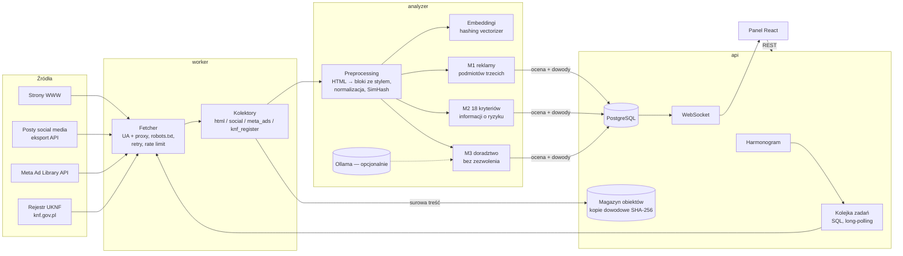

# Architektura

## Przepływ danych

1. **Harmonogram** (`api/app/main.py`) co `SWEEP_INTERVAL_MINUTES` dodaje aktywne źródła do kolejki; rejestr UKNF raz na dobę.
   Zawieszone zadania wracają do kolejki (maks. 3 próby).
2. **Worker** pobiera zadanie (long-polling `GET /internal/jobs/claim`, atomowe przejęcie przez warunkowy `UPDATE`),
   ściąga zasób i dzieli go kolektorem na pozycje (np. odpowiedź Meta Ad Library → jedna pozycja na reklamę).
3. **Analyzer** (bezstanowy) zwraca ujednolicony obiekt: dokument + oceny modułów (agregator wyników 1, 2, 3).
4. **API** zapisuje surową treść w magazynie obiektów (adres = SHA-256), upsertuje dokument (pierwsze/ostatnie
   wykrycie, liczba zmian treści, near-duplicate przez SimHash) i wyniki. Nowy wynik powyżej progu → zdarzenie `alert`
   przez WebSocket.

## Ocena ryzyka

Każdy moduł zwraca ocenę 0–100 jako **noisy-OR** sygnałów: `100 · (1 − Π(1 − wᵢ))`. Wagi są jawne
(`analyzer/rules_m2.py`, `analyzer/modules.py`), więc każdą ocenę da się wyjaśnić listą sygnałów i dowodów.
Poziomy: krytyczne ≥ 85, wysokie ≥ 70, średnie ≥ 50. **Próg alertu** jest osobny dla każdego modułu i ustawiany
w panelu Kalibracja, który liczy precyzję, pełność i F1 na korpusie z etykietami dla każdego progu 0–100.

| Moduł | Najważniejsze sygnały |
|---|---|
| M1 | wzmianka o firmie z rejestru UKNF, kod/link polecający, wezwanie do założenia konta, brak oznaczenia reklamy, materiał nie pochodzi z kanału firmy |
| M2 | 18 kryteriów z zasobu UKNF; reguły prezentacyjne (rozmiar czcionki, kontrast WCAG, przypisy, sekcje zwijane, responsywność) działają na stylach wyliczonych z CSS |
| M3 | frazy doradcze, personalizacja, instrumenty finansowe, odpłatność, podobieństwo semantyczne do ofert doradczych, brak w rejestrze (silnie obniża ocenę obecność w rejestrze) |

## Otwartość na rozbudowę

- **Nowe źródło** = nowa funkcja w `worker/collectors.py` (`COLLECTORS[kind]`).
- **Nowa reguła** = `RuleSpec` + blok w `rules_m2.evaluate`.
- **Mocniejszy model** = podmiana `vectors.embed` (BERT) lub `llm.advice_probability` (dowolny model w Ollama/vLLM).
- **Skalowanie**: worker i analyzer są bezstanowe — `docker compose up --scale worker=4 --scale analyzer=2`.

## Ograniczenia prototypu

- Platformy społecznościowe są obsługiwane przez eksporty i API (format Meta Ad Library, JSON postów),
  bez logowania i obchodzenia zabezpieczeń platform.
- Reguła 8 (responsywność) to statyczna symulacja na podstawie CSS; pełny rendering (Playwright) jest punktem rozbudowy.
- CSS jest rozwiązywany dla stylów inline i prostych selektorów (`tag`, `.klasa`, `#id`).
- Kalibracja korzysta z korpusu syntetycznego; po otrzymaniu próbek UKNF wystarczy dodać ich etykiety.
